<!-- banner -->

  

<!-- roles + socials -->

  
  <a href="https://www.linkedin.com/in/eiffelputri/">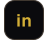</a>
  
  

 

<!-- about -->

I work across full-stack development and software quality assurance, and outside of work I keep building things out of curiosity, mostly kept private for now. From time to time, I take part in programming contests ✨

> [!NOTE]
> You'll find both finished projects and works in progress here. 
> Every repository is part of the process. ヾ(^▽^)

 

<!-- tech stack -->

<table>
  <tr>
    <td valign="middle" width="200"><b>Development</b></td>
    <td>
      
      
      
      
      
      
      
      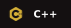
      
      
      
      
      
      
      
      
      
      
    </td>
  </tr>
  <tr>
    <td valign="middle" width="200"><b>QA &amp; Analysis</b></td>
    <td>
      
      
      
      
      
      
      
      
      
      
      
    </td>
  </tr>
</table>

 

<!-- stats -->

<table>
<tr>
<td width="435" valign="top">

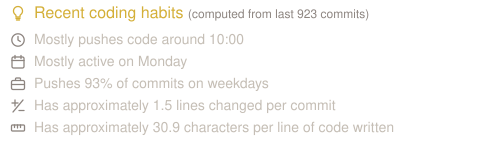

</td>
<td width="435" valign="top">

</td>
</tr>
</table>

 

<!-- featured work -->

> ###  &nbsp; LyrStack
> A falling-block puzzle game where song lyrics become pieces. Made for the Magical Mirai 2026 Programming Contest.
>
> 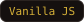 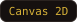 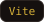 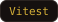 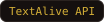 &nbsp;

<table>
<tr>
<td width="435" valign="top">

<b>◆ Bimbingan Online (DiBO)</b> &nbsp;·&nbsp;ᴘʀɪᴠᴀᴛᴇ

A thesis guidance system that connects students, advisors, and coordinators, from advisor requests to defense scheduling.

 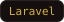 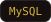

</td>
<td width="435" valign="top">

<b>◆ Polidoku</b> &nbsp;·&nbsp;ᴘᴜʙʟɪᴄ

A clinic management system that handles patient registration, doctor schedules, medical records, and billing.

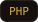  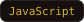 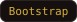 &nbsp;

</td>
</tr>
</table>

 

<!-- quote -->

  

<!-- footer -->

  

<code>thanks for visiting · made under the stars ✦</code>

© 2026 Clara E. E. S. P. · @eiffelputri · all rights reserved 
visual direction inspired by <b>Honkai: Star Rail</b> · © HoYoverse — fan tribute, not affiliated

